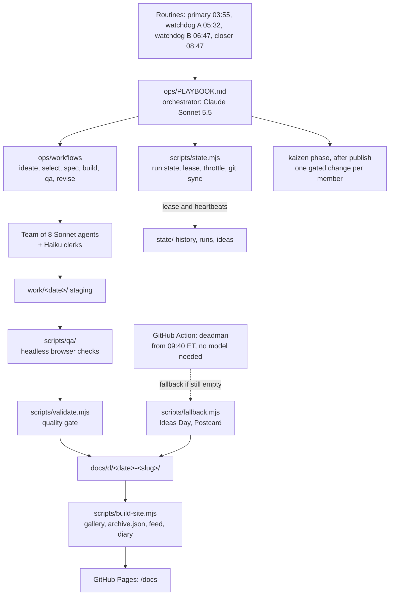

# Sonnet Every Day

**One new, sophisticated, one-of-a-kind thing that fits on a static web page. Every single morning. Built while you sleep.**

At 03:55 New York time a Claude Sonnet 5.5 orchestrator wakes up, assembles a team of eight Claude Sonnet agents plus a few Claude Haiku clerks, and gets to work. Around 08:00 the day's project is live (a guideline: occasionally later, because quality beats punctuality): a poker range explorer one day, a hockey-physics toy the next, a deeply silly instrument after that. No two alike, none of them throwaway.

**See it:** <https://ph05.github.io/sonnet-every-day/>

Day 1 is 2026-10-10. The gallery keeps every day, shows a streak, and is honest about the days that did not go to plan.

---

## What this is

* A daily build pipeline that runs unattended, plus the gallery that shows its output.
* Each project is a self-contained static page: no server, no build step, no trackers, no CDNs. It works offline.
* Variety is the whole game. The system is told what it built before and is forced to look somewhere new: poker ranges and GTO, Balatro and mod ideas, hockey, Reddit-born ideas, pop-flavored current events, humor, science, music, tools, weird art, and whatever the dice say.
* Everything is plain Node 22 with zero npm dependencies. The "brain" is a set of prompts and role files in [`ops/`](ops/); the "hands" are small, tested scripts in [`scripts/`](scripts/).

## How a day works

```
03:55  preflight   sync, claim the day, read the history and the lens assignments
       ideate      8 scouts research and propose; a clerk dedupes; a novelty gate and verifiers
                   narrow it to EXACTLY 10 researched ideas
       select      a judge panel scores the 10 and picks the winner (and at most one to save)
       spec        architect, artisan and engineer write the spec, the design and the file map
       build       builders work on disjoint files in parallel
       QA          headless browser on desktop and phone, light and dark, plus a monkey test;
                   a critic ranks the defects; a clerk proofreads
       revise      owners fix the serious defects and QA runs again
       package     thumbnail, metadata, validation, gallery rebuild, run report
       publish     push, then check the live site lists today
       kaizen      after publish, each team member makes one small improvement to the swarm
05:32  watchdog A  a stuck or dead primary is taken over
06:47  watchdog B  a slow primary is asked to scale down
~08:00 live target (a guideline; a healthy run is never cut off before 09:30)
08:47  closer      babysits a healthy run until 09:30, then salvages or falls back
10:30  hard stop   anything still unpublished is force-resolved
```

Phase 1 is the heart of it: **ten well-researched ideas every day**. Only the winner is built. One unbuilt idea may be saved for tomorrow, and only once, so the ideas stay fresh.

### Something always ships

A day is never allowed to be blank. Watchdog sessions and a model-free GitHub Action keep watch, and the system steps down a tier rather than leave the day empty. 08:00 is a target, not a cliff: a healthy run that is still polishing gets until 09:30, and anything unpublished at 10:30 is force-resolved.

| Time (ET) | Who | What they do |
|---|---|---|
| 03:55 | primary | Runs the whole day. |
| 05:32 | watchdog A | Healthy primary: nothing. Dead or stuck: takes over from the last finished phase. |
| 06:47 | watchdog B | Asks a slow primary to scale down, or takes over. |
| 08:47 | closer | Waits for a healthy run to finish (until 09:30), salvages a half-built page if there is one, otherwise publishes a fallback. |
| 09:37 | closer backup | Same prompt, fifty minutes later: stops quietly if the day is published, finishes the job if the closer's session died. |
| 09:40 | deadman Action | No Claude needed (GitHub may start it hours late). Publishes a fallback if the day is still empty and nobody is alive, or after the 10:30 hard stop. |

| Tier | What ships | When it applies |
|---|---|---|
| **T1** | Full build with a revise loop | A run starting before 04:45 |
| **T2** | Compact build, one builder pair, revised like a full one when QA finds an S2 or four S3 | Starting before 07:00, or a primary asked to scope down |
| **T3** | **Ideas Day**: the ten researched ideas as an interactive page, marked as a fallback | Ideas exist but there is no time to build (before 08:45) |
| **T4** | **Postcard**: a deterministic generative page that says today's build did not complete | Anything else; needs nothing at all |

Fallback days count as days but do not use up a category. A primary that recovers late can still replace a fallback until 23:59.

How many of the eight agents run at once depends on the machine: the Workflow tool runs `min(16, CPUs - 2)` agent calls at a time, which is two on the current 4-CPU cloud container. With fewer than six slots the planner prices a full build as infeasible at 03:55, so the day is a compact T2 build from the start (both days so far ended as T2); six or more slots bring T1 back.

## A swarm that improves itself

The team is built to be resilient, curious and proactive, and the repo shows it.

* **A charter.** [`ops/CULTURE.md`](ops/CULTURE.md) is read by every agent: assume partial failure and checkpoint, ask why and run the cheap experiment, fix what you notice and leave a handoff for tomorrow.
* **One minor change per member per day.** After the day's page is published, each of the nine team members makes exactly one small change that would make the whole system better. It does not have to be in the member's own lane: it is an observation turned into a small, safe diff. Because it runs after publish, it can never endanger the day.
* **A gate that does not bend.** `scripts/kaizen.mjs` caps the size of each change, limits it to an allowlist of paths, refuses anything near the safety rules or the gate itself, requires every test to still pass (none deleted or skipped), and keeps the docs from bloating. A change that fails is reverted and logged as a lesson, not a failure.
* **Proposals for the owner.** A good idea that needs a protected file is never applied. It becomes a note in [`ops/kaizen/proposals/`](ops/kaizen/proposals/) for the owner to accept or ignore.
* **A public diary.** Every change, every rejected attempt and every open question is written to the swarm's diary on the site (`docs/kaizen/`, linked from the gallery) and to [`ops/kaizen/LOG.md`](ops/kaizen/LOG.md), newest first.
* **Memory across days.** Each morning starts with a premortem of the day's risks, and each night ends with a short handoff and a blameless note on what went wrong.

## How it is kept running

There is no server. Each role (primary, watchdog A, watchdog B, closer, closer backup, and a manual one that only you fire) is **one long-lived Claude Code session** with this repo attached as its source, and a **routine** wakes it: a cron trigger in `America/New_York` time that adds a new turn to that session, with no text of its own beyond the routine's prompt ("read `ops/PLAYBOOK.md` and do your role"). The conversation is not the memory, the repo is: every phase is checkpointed to git, so a session can die, be compacted or be replaced and the next turn carries on from the files. A turn orchestrates by launching background Workflow scripts, and a timer ("phase watch") wakes it if one of them stalls. The session ids are in [`state/routines.json`](state/routines.json); how to recreate the five sessions and routines (with their cron lines, `CRON_TZ=America/New_York 55 3 * * *` for the primary and so on) is in [`ops/prompts/README.md`](ops/prompts/README.md).

The cloud network is restricted: web search works, opening most pages does not. Research therefore rests on search results, and the "is the site live" check from the cloud answers "unreachable", which is normal. You can allow more hosts in the cloud environment's network settings; the steps and the list of hosts are in [`ops/OPERATING.md`](ops/OPERATING.md) ("What the cloud can reach").

## The rules

* **Distinct.** A novelty gate compares every candidate with the whole history: category cooldowns, mechanic cooldowns, tag overlap, title similarity. Same idea in new clothes does not pass.
* **Sophisticated.** A real mechanic with depth, not a lorem-ipsum toy. A full build has to carry at least 700 lines of its own logic, styling and markup.
* **Static and offline.** The page works with bundled data. Live fetches are allowed only as a graceful extra, only for hosts the project declares, and the page's Content-Security-Policy enforces it.
* **Safe.** No analytics, no real branding, no real-money gambling, no personal data, no presenting fiction as fact. Every factual claim carries a dated source, and a claim without a source that was actually opened is never published as fact.
* **Politics are rare.** At most one in any 14 days, satirical or playful, never partisan advocacy. Current events lean pop culture, games, tech, science and hockey.
* **One saved idea.** At most one unbuilt idea carries over, for one day, and only if it does not go stale.

## How a daily project is judged

1. **The ten ideas are scored 0 to 10** on sophistication, delight, distinctness, feasibility, timeliness, interest fit, polish potential and safety. The judge panel's winner is built.
2. **Hard gates before anything goes live.** `scripts/validate.mjs` checks the metadata, the thumbnail, the page shell, the Content-Security-Policy, that there are no external resources, secrets or forbidden files, that every script parses, and the size and code-volume limits. A project that fails is left out and can never break the gallery.
3. **A real browser looks at it.** Headless Chromium loads the page on desktop and phone in light and dark, records console errors, failed or non-local requests, layout overflow and missing labels, then hammers it with random clicks and keys to catch crashes and hangs.
4. **A critic ranks what is left.** Serious defects go back to their owners for a fix. The bar is "would a person bookmark this or send it to a friend": keyboard and touch support, 360px layouts, light and dark, reduced motion, shareable state, a making-of panel with the day's sources.

## Architecture



Everything lives in git, on one work branch, so any session can pick up where another one stopped.

```
config.json            the knobs: schedule, tiers, budget levels, novelty rules, limits
ops/
  PLAYBOOK.md          the orchestrator's brain; routines only say "read this and do it"
  CULTURE.md           the team charter: resilient, curious, proactive
  kaizen/              the ledger (LOG.md, INDEX.json) and proposals for the owner
  OPERATING.md         the owner's guide
  FAILURE_MODES.md     what can go wrong and what the system does about it
  CONTRACT.md          the exact shapes and CLIs every component is built against
  prompts/             the routine prompts
  workflows/           ideate, select, spec, build, qa, revise, kaizen
  roles/ rubrics/      what each agent is, and how work is judged
  templates/           the page shell every project starts from
scripts/
  state.mjs            run state, lease, decision table, throttle, sync
  heartbeat.mjs        liveness, pushed to a separate heartbeat branch
  kaizen.mjs           the daily self-improvement gate and ledger
  validate.mjs         project and repo validation
  novelty.mjs          the no-repeats gate and the category mix
  lenses.mjs           the daily research lenses and provocations
  history.mjs          the history ledger
  build-site.mjs       the gallery, archive.json, feed, sitemap, swarm diary
  verify-live.mjs      checks the published site lists today
  fallback.mjs         Ideas Day and Postcard generators
  deadman.mjs          the model-free safety net
  qa/                  headless browser checks
site-src/              the gallery front-end
state/                 history, carry-over idea, throttle, per-day runs and ideas
docs/                  the published site (the folder GitHub Pages serves, /docs)
tests/                 node:test suites (no dependencies)
```

## Setup checklist

1. **Enable GitHub Pages.** Repo **Settings**, **Pages**, **Build and deployment**: **Deploy from a branch**, branch `main`, folder `/docs` (the second dropdown; the preselected `/ (root)` is wrong), **Save**. The site is then at <https://ph05.github.io/sonnet-every-day/> after the first deploy (a few minutes). The daily build pushes the work branch; the `sync-main` Action fast-forwards `main` to it after every push that changes `docs/`, `.github/` or `config.json`, so the site follows. **If that address shows this README instead of the gallery, the folder is `/ (root)`:** open Settings, Pages, choose `/docs` in that dropdown and Save, one click (`ops/OPERATING.md`, "Turn on GitHub Pages", says what each wrong setting looks like).
2. **Create the sessions and routines** (primary, watchdog A, watchdog B, closer, closer backup) from the table and files in [`ops/prompts/README.md`](ops/prompts/README.md): one session per role created with this repo as its source, then one cron trigger per session (`persistent_session_id`, no text, `CRON_TZ=America/New_York`). Record the ids in `state/routines.json`. A routine keeps its own copy of its prompt: after `ops/prompts/_bootstrap.md` or a prompt file is edited, refresh the six routines with `update_trigger`, asked in each role's own session (a routine's prompt can only be changed from the conversation it posts into; `ops/prompts/README.md`, "Refresh the routines after editing a prompt", prints the text).
3. **Run a day by hand** whenever you want one (the first day was built this way) by firing the manual routine with the text `ROLE_OVERRIDE=manual RUN_DATE=<date> TARGET_TIER=1`; see [`ops/OPERATING.md`](ops/OPERATING.md).
4. **Do not merge pull requests into `main`.** `main` follows the work branch by fast-forward (`.github/workflows/sync-main.yml`); a merge commit on `main` stops that until `main` is merged back into the work branch once (`ops/OPERATING.md`, "Merge the branch to `main`"). GitHub runs scheduled workflows only from the default branch, which is why the `deadman` Action needs `main` current.

CI (`.github/workflows/validate.yml`) runs the tests and `node scripts/validate.mjs repo` on every push and pull request.

## Operating notes

Pausing, resuming, steering the budget, rerunning or removing a day, and reading the run state are all in [`ops/OPERATING.md`](ops/OPERATING.md). If something looks wrong, start with `node scripts/state.mjs status` and then [`ops/FAILURE_MODES.md`](ops/FAILURE_MODES.md).

## Cost and limits

It runs entirely inside a Claude subscription and is configured to never buy overage. The budget has four levels (`all-in`, `balanced`, `lean`, `minimal`), `balanced` by default (about 3 million output tokens a day at most; a compact Tier-2 day uses roughly 2.2 million). Before every phase the operator reads its own plan state: an overage in use or a rejected plan limit stops the run and publishes a fallback instead, and a nearly full short window steps the level down; five clean days in a row step it back up. The owner can lift the budget for a while (`budget.ownerOverride` in `config.json`: a level until a stated time, after which the normal level applies again by itself); that never lifts the no-overage rule. Cheap Haiku clerks do the repetitive chores so the Sonnet agents spend their effort on the thinking. Details: [`ops/OPERATING.md`](ops/OPERATING.md).

## Who builds what

The orchestrator is Claude Sonnet 5.5. The team agents are Claude Sonnet; the clerks are Claude Haiku. Clerks never write shipped game logic or art, and are never the only judge of novelty, safety or quality.

## License

[MIT](LICENSE), copyright ph05.
