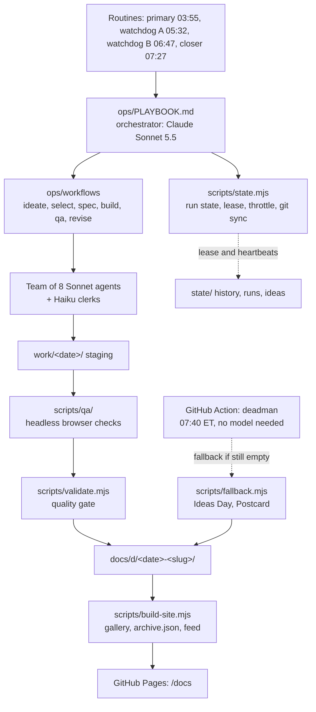

# Sonnet Every Day

**One new, sophisticated, one-of-a-kind thing that fits on a static web page. Every single morning. Built while you sleep.**

At 03:55 New York time a Claude Sonnet 5.5 orchestrator wakes up, assembles a team of eight Claude Sonnet agents plus a few Claude Haiku clerks, and gets to work. By 08:00 the day's project is live: a poker range explorer one day, a hockey-physics toy the next, a deeply silly instrument after that. No two alike, none of them throwaway.

**See it:** <https://ph05.github.io/sonnet-every-day/>

Day 1 is 2026-10-09. The gallery keeps every day, shows a streak, and is honest about the days that did not go to plan.

---

## What this is

* A daily build pipeline that runs unattended, plus the gallery that shows its output.
* Each project is a self-contained static page: no server, no build step, no trackers, no CDNs. It works offline.
* Variety is the whole game. The system is told what it built before and is forced to look somewhere new: poker ranges and GTO, Balatro and mod ideas, hockey, Reddit-born ideas, pop-flavored current events, humor, science, music, tools, weird art, and whatever the dice say.
* Everything is plain Node 22 with zero npm dependencies. The "brain" is a set of prompts and role files in [`ops/`](ops/); the "hands" are small, tested scripts in [`scripts/`](scripts/).

## How a day works

```
03:55  preflight   sync, claim the day, read the history and the lens assignments
       ideate      8 scouts research and propose; a clerk dedupes; a novelty gate and verifiers
                   narrow it to EXACTLY 10 researched ideas
       select      a judge panel scores the 10 and picks the winner (and at most one to save)
       spec        architect, artisan and engineer write the spec, the design and the file map
       build       builders work on disjoint files in parallel
       QA          headless browser on desktop and phone, light and dark, plus a monkey test;
                   a critic ranks the defects; a clerk proofreads
       revise      owners fix the serious defects and QA runs again
       package     thumbnail, metadata, validation, gallery rebuild, run report
       publish     push, then check the live site lists today
08:00  deadline
```

Phase 1 is the heart of it: **ten well-researched ideas every day**. Only the winner is built. One unbuilt idea may be saved for tomorrow, and only once, so the ideas stay fresh.

### Something always ships

A day is never allowed to be blank. Watchdog sessions and a model-free GitHub Action keep watch, and the system steps down a tier rather than miss the deadline.

| Time (ET) | Who | What they do |
|---|---|---|
| 03:55 | primary | Runs the whole day. |
| 05:32 | watchdog A | Healthy primary: nothing. Dead or stuck: takes over from the last finished phase. |
| 06:47 | watchdog B | Asks a slow primary to scale down, or takes over. |
| 07:27 | closer | Guarantees a page is live by 08:00. |
| 07:40 | deadman Action | No Claude needed. Publishes a fallback if the day is still empty. |

| Tier | What ships | When it applies |
|---|---|---|
| **T1** | Full build with a revise loop | A run starting before 04:45 |
| **T2** | Compact build, one builder pair | Starting before 06:45, or a primary asked to scope down |
| **T3** | **Ideas Day**: the ten researched ideas as an interactive page, marked as a fallback | Ideas exist but there is no time to build (before 07:25) |
| **T4** | **Postcard**: a deterministic generative page that says today's build did not complete | Anything else; needs nothing at all |

Fallback days count as days but do not use up a category. A primary that recovers late can still replace a fallback until 23:59.

## The rules

* **Distinct.** A novelty gate compares every candidate with the whole history: category cooldowns, mechanic cooldowns, tag overlap, title similarity. Same idea in new clothes does not pass.
* **Sophisticated.** A real mechanic with depth, not a lorem-ipsum toy. A full build has to carry at least 700 lines of its own logic, styling and markup.
* **Static and offline.** The page works with bundled data. Live fetches are allowed only as a graceful extra, only for hosts the project declares, and the page's Content-Security-Policy enforces it.
* **Safe.** No analytics, no real branding, no real-money gambling, no personal data, no presenting fiction as fact. Every factual claim carries a dated source, and a claim without a source that was actually opened is never published as fact.
* **Politics are rare.** At most one in any 14 days, satirical or playful, never partisan advocacy. Current events lean pop culture, games, tech, science and hockey.
* **One saved idea.** At most one unbuilt idea carries over, for one day, and only if it does not go stale.

## How a daily project is judged

1. **The ten ideas are scored 0 to 10** on sophistication, delight, distinctness, feasibility, timeliness, interest fit, polish potential and safety. The judge panel's winner is built.
2. **Hard gates before anything goes live.** `scripts/validate.mjs` checks the metadata, the thumbnail, the page shell, the Content-Security-Policy, that there are no external resources, secrets or forbidden files, that every script parses, and the size and code-volume limits. A project that fails is left out and can never break the gallery.
3. **A real browser looks at it.** Headless Chromium loads the page on desktop and phone in light and dark, records console errors, failed or non-local requests, layout overflow and missing labels, then hammers it with random clicks and keys to catch crashes and hangs.
4. **A critic ranks what is left.** Serious defects go back to their owners for a fix. The bar is "would a person bookmark this or send it to a friend": keyboard and touch support, 360px layouts, light and dark, reduced motion, shareable state, a making-of panel with the day's sources.

## Architecture



Everything lives in git, on one work branch, so any session can pick up where another one stopped.

```
config.json            the knobs: schedule, tiers, budget levels, novelty rules, limits
ops/
  PLAYBOOK.md          the orchestrator's brain; routines only say "read this and do it"
  OPERATING.md         the owner's guide
  FAILURE_MODES.md     what can go wrong and what the system does about it
  CONTRACT.md          the exact shapes and CLIs every component is built against
  prompts/             the routine prompts
  workflows/           ideate, select, spec, build, qa, revise
  roles/ rubrics/      what each agent is, and how work is judged
  templates/           the page shell every project starts from
scripts/
  state.mjs            run state, lease, decision table, throttle, sync
  heartbeat.mjs        liveness that does not depend on the orchestrator
  validate.mjs         project and repo validation
  novelty.mjs          the no-repeats gate and the category mix
  lenses.mjs           the daily research lenses and provocations
  history.mjs          the history ledger
  build-site.mjs       the gallery, archive.json, feed, sitemap
  verify-live.mjs      checks the published site lists today
  fallback.mjs         Ideas Day and Postcard generators
  deadman.mjs          the model-free safety net
  qa/                  headless browser checks
site-src/              the gallery front-end
state/                 history, carry-over idea, throttle, per-day runs and ideas
docs/                  the published site (GitHub Pages root)
tests/                 node:test suites (no dependencies)
```

## Setup checklist

1. **Enable GitHub Pages.** Repo **Settings**, **Pages**, **Build and deployment**: **Deploy from a branch**, branch `claude/sonnet-every-day`, folder `/docs`, **Save**.
2. **Create the four routines** (primary, watchdog A, watchdog B, closer) from the table and files in [`ops/prompts/README.md`](ops/prompts/README.md). Cron times are in `America/New_York`.
3. **Run the first day by hand** by firing the primary with the text `ROLE_OVERRIDE=manual RUN_DATE=2026-10-09 TARGET_TIER=1`.
4. **Optional but recommended: merge the work branch to `main`.** GitHub runs scheduled workflows only from the default branch, so the `deadman` Action sleeps until `.github/workflows/deadman.yml` is on `main`. Until then it can still be started by hand from the Actions tab.

CI (`.github/workflows/validate.yml`) runs the tests and `node scripts/validate.mjs repo` on every push and pull request.

## Operating notes

Pausing, resuming, steering the budget, rerunning or removing a day, and reading the run state are all in [`ops/OPERATING.md`](ops/OPERATING.md). If something looks wrong, start with `node scripts/state.mjs status` and then [`ops/FAILURE_MODES.md`](ops/FAILURE_MODES.md).

## Cost and limits

It runs entirely inside a Claude subscription and is configured to never buy overage. The budget has four levels (`all-in`, `balanced`, `lean`, `minimal`), `balanced` by default. A rate limit, usage limit or budget signal steps the level down automatically and the day finishes at a lower tier; five clean days in a row step it back up. Cheap Haiku clerks do the repetitive chores so the Sonnet agents spend their effort on the thinking.

## Who builds what

The orchestrator is Claude Sonnet 5.5. The team agents are Claude Sonnet; the clerks are Claude Haiku. Clerks never write shipped game logic or art, and are never the only judge of novelty, safety or quality.

## License

[MIT](LICENSE), copyright ph05.
